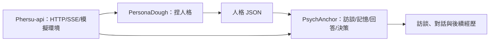

# Phersu
> Phersu（斐爾蘇）是古伊特拉斯坎文明神話與葬禮儀式中的一個神祕戴面具角色。

Phersu 是整組專案的統一工作區與導覽入口。PersonaDough、PsychAnchor、Phersu-api 各自保留獨立 repo，透過 Git submodule 放在這裡。原型尚未完成。

| Repo | 職責 | 終點/輸出 |
|---|---|---|
| [PersonaDough](https://github.com/llm-psychology/PersonaDough/tree/refactor/repository-split) | 捏出人格 | 人格 JSON，包含初始背景故事與語言風格 |
| [PsychAnchor](https://github.com/llm-psychology/PsychAnchor/tree/refactor/extract-anchoring) | 訪談、記憶、回答與行為一致性 | 訪談索引、回答、情境決策|
| [Phersu-api](https://github.com/llm-psychology/Phersu-api) | HTTP、SSE、背景任務、模擬環境與展示 adapter | API 與事件串流 |
| [Phersu](https://github.com/llm-psychology/Phersu) | submodule 工作區、導覽、共用資料格式與整合測試 | 開發入口 |



故事分為兩種：**初始背景故事**由 PersonaDough 產生並固定；**後續經歷/延伸故事**屬於 PsychAnchor，將儲存在humanoid_database內。

## 開發環境

直接取得工作區與三個子 repo：

```powershell
git clone --recurse-submodules https://github.com/llm-psychology/Phersu.git
cd Phersu
```

如果已經 clone Phersu，補齊子 repo：

```powershell
git submodule update --init --recursive
```

工作區：

```text
Phersu/
├── PersonaDough/       # submodule：人格生成
├── PsychAnchor/        # submodule：訪談、記憶與人格決策
├── Phersu-api/         # submodule：HTTP/SSE 與模擬環境
├── .gitmodules
├── docs/
├── tests/
└── requirements-dev.txt
```

兩個既有 repo 的拆分以分支與 PR 提供，尚未合併 main。submodule 目前對應 PersonaDough 的 `refactor/repository-split`、PsychAnchor 的 `refactor/extract-anchoring` 與 Phersu-api 的 `main`。Phersu 記錄各子 repo 的確切 commit，clone 時會取得同一組版本。

Phersu-api 的 Python 套件名稱仍為 `persona-api`/`persona_api`。進入 Phersu 根目錄，建立 Python 3.10+ 虛擬環境後：

```powershell
python -m pip install -r requirements-dev.txt
python -m pytest PersonaDough/tests PsychAnchor/tests Phersu-api/tests tests
python tools/offline_demo.py
```

`offline_demo.py` 使用固定回應與向量，只驗證跨 repo 流程，不代表真實 LLM 已測試。真實聊天分別參照子 repo README；三個 repo 共用同一組模型設定及絕對資料路徑。

`.gitmodules` 記錄子 repo 的位置、遠端與更新分支；`repositories.json` 補充 Python 套件名稱。安裝使用工作區內的 Python editable dependency，套件尚未發佈到 PyPI。

## 更新子 repo

取得 Phersu 所記錄的版本：

```powershell
git submodule update --init --recursive
```

開發子 repo 時，先進入該目錄並切到工作分支，再 commit、push。回到 Phersu，另外提交更新的 submodule commit 指標。主 repo 不會自動包含子 repo 尚未提交的程式變更。

## 依賴方向

Repo 依賴方向為 `Phersu-api → PsychAnchor → PersonaDough`，API 也可直接使用 PersonaDough。

PsychAnchor 只重用 PersonaDough 的資料格式驗證、路徑與 `runtime/` adapter，沒有呼叫人格生成器。共用底層工具先留在 PersonaDough，避免此次拆分多出第五個 repo；若兩者未來需要獨立發布週期，可再抽出共用套件。

## 實作狀態

已存在：人格生成、合成訪談、RAG、角色對話與情境決策原型。

未完成：量化人格錨定、人格偏離評估/校正、完整事件記憶與後續故事生成、多租戶、正式 CI/CD/容器部署及維運驗證。

## 文件

- [模組邊界](docs/repository-boundaries.md)
- [資料格式與交換規則](docs/data-format.md)
- [拆分前的 PersonaDough 原型與完整歷史](https://github.com/llm-psychology/PersonaDough-archive)：獨立封存，不參與本專案執行。

本專案採用 GPL-3.0 授權，詳見 [LICENSE](LICENSE)。
