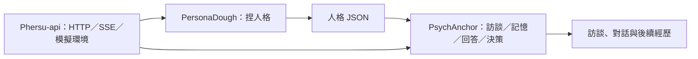

# Phersu

Phersu 是畢業專題的導覽與整合入口。原型尚未完成，目前先依領域拆成三個 Python repo，再由這裡說明如何合作。

| Repo | 職責 | 終點／輸出 |
|---|---|---|
| [PersonaDough](https://github.com/llm-psychology/PersonaDough/tree/refactor/repository-split) | 捏出人格 | 人格 JSON，包含初始背景故事與語言風格 |
| [PsychAnchor](https://github.com/llm-psychology/PsychAnchor/tree/refactor/extract-anchoring) | 訪談、記憶、回答與行為一致性 | 訪談索引、回答、情境決策|
| [Phersu-api](https://github.com/llm-psychology/Phersu-api) | HTTP、SSE、背景任務、模擬環境與展示 adapter | API 與事件串流 |
| [Phersu](https://github.com/llm-psychology/Phersu) | 導覽、共用資料格式與整合測試 | 開發入口 |



故事分為兩種：**初始背景故事**由 PersonaDough 產生並固定；**後續經歷／延伸故事**屬於 PsychAnchor，將儲存在humanoid_database內。

## 開發環境

兩個既有 repo 的拆分以分支與 PR 提供，尚未合併 main。請使用下列分支準備相鄰工作區：

```powershell
git clone --branch refactor/repository-split https://github.com/llm-psychology/PersonaDough.git
git clone --branch refactor/extract-anchoring https://github.com/llm-psychology/PsychAnchor.git
git clone https://github.com/llm-psychology/Phersu-api.git persona-api
git clone https://github.com/llm-psychology/Phersu.git persona-platform
```

工作區：

```text
專題專案/
├── PersonaDough/       # 既有 repo 的拆分分支
├── PsychAnchor/        # 既有 repo 的拆入分支
├── persona-api/        # Phersu-api repo
└── persona-platform/   # Phersu 主導覽 repo
```

本地資料夾沿用原名，所以上面的 clone 命令指定了目的目錄。Phersu-api 的 Python 套件名稱仍為 `persona-api`／`persona_api`，不隨 GitHub repo 更名。

進入 `persona-platform` 資料夾，建立 Python 3.10+ 虛擬環境後：

```powershell
python -m pip install -r requirements-dev.txt
python -m pytest ../PersonaDough/tests ../PsychAnchor/tests ../persona-api/tests tests
python tools/offline_demo.py
```

`offline_demo.py` 使用固定回應與向量，只驗證跨 repo 流程，不代表真實 LLM 已測試。真實聊天分別參照子 repo README；三個 repo 共用同一組模型設定及絕對資料路徑。

`repositories.json` 記錄相鄰目錄、遠端與目前整合分支。使用 Python editable dependency 整合；套件尚未發佈到 PyPI。

## 依賴方向

Repo 依賴方向為 `Phersu-api → PsychAnchor → PersonaDough`，API 也可直接使用 PersonaDough。

PsychAnchor 只重用 PersonaDough 的資料格式驗證、路徑與 `runtime/` adapter，沒有呼叫人格生成器。共用底層工具先留在 PersonaDough，避免此次拆分多出第五個 repo；若兩者未來需要獨立發布週期，可再抽出共用套件。

## 實作狀態

已存在：人格生成、合成訪談、RAG、角色對話與情境決策原型。

未完成：量化人格錨定、人格偏離評估／校正、完整事件記憶與後續故事生成、多租戶、正式 CI/CD／容器部署及維運驗證。

## 文件

- [模組邊界](docs/repository-boundaries.md)
- [資料格式與交換規則](docs/data-format.md)
- [拆分前的 PersonaDough 原型與完整歷史](https://github.com/llm-psychology/PersonaDough-archive)：獨立封存，不參與本專案執行。

本專案採用 GPL-3.0 授權，詳見 [LICENSE](LICENSE)。
